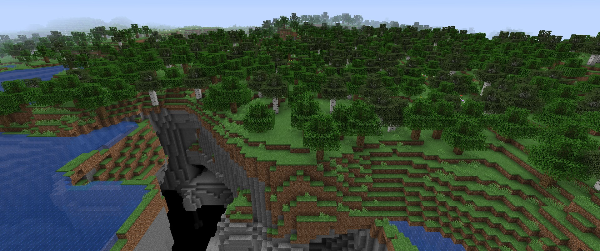
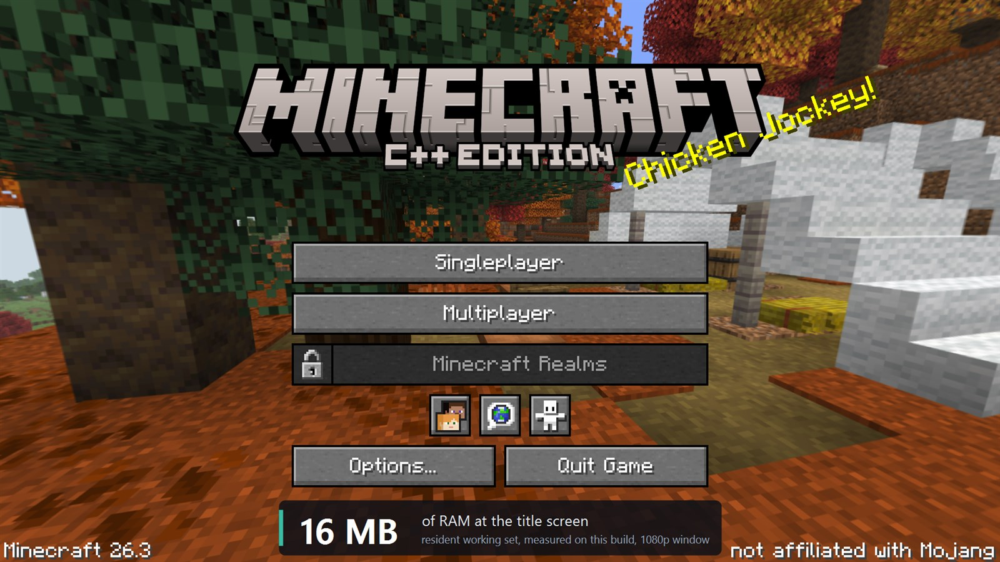
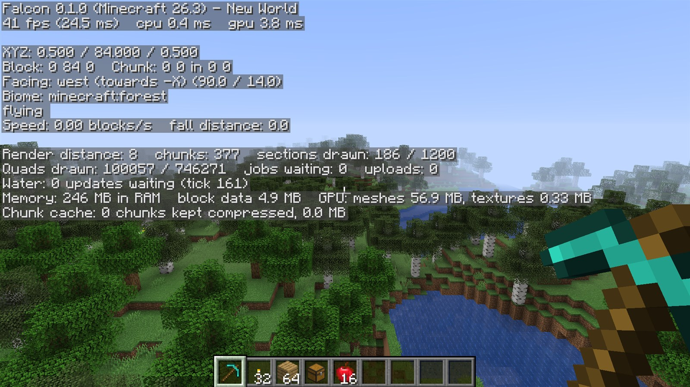
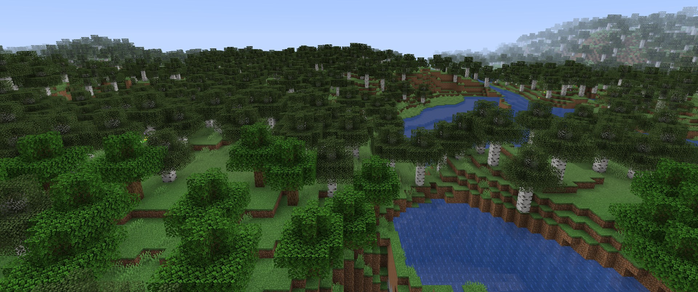

# Falcon

**A from-scratch C++20 reimplementation (OpenGL and Vulkan) of the Minecraft Java Edition client (26.3)** - the menus, the options screens and a
real singleplayer world with the game's own terrain generator, light, physics and inventory. It starts in **16 MB** and a
**32-chunk world settles at about 1 GB** (more while it loads).



<table>
  <tr>
    <td width="50%"></td>
    <td width="50%"></td>
  </tr>
  <tr>
    <td align="center"><sub><b>Title screen</b> - 16 MB resident, measured</sub></td>
    <td align="center"><sub><b>In game at render distance 8</b> - the F3 screen shows 244 MB in RAM</sub></td>
  </tr>
</table>



<sub>Screenshots are Falcon's own output (HUD hidden with F1 for the two wide shots). They show the game's textures, which Falcon reads
from your own installation: see "Game assets" below.</sub>

## What it is

* **The client's screens**, laid out and drawn like the real 26.3 ones: the title screen with its panorama, Singleplayer and Create New
  World, Multiplayer, all the Options screens, key binds, languages, resource packs.
* **Singleplayer** in a world made by a port of the game's own world generator (noise terrain, aquifers, surface rules, ore veins), with a
  chunk light engine and smooth lighting, biome tints, water that flows, the game's player physics at 20 ticks a second, block
  breaking and placing, survival and creative inventories (with the real player model), crafting, F3 chords and the game mode
  switcher, a first-person hand and held light.
* **Small and fast**: a few MB of RAM at the menu, mesh buffers that shrink when you lower the Render Distance, chunks kept as
  compressed copies when they go out of range, and back-face and leaf-detail culling that took a 32-chunk forest from 10.5 ms to 6.5 ms a
  frame on a Ryzen 5 5600G with an RX 580. Numbers and method are in the README below.
* **Checked against the real game**: `tools/vanilla-reference.ps1` makes a world with the real server on a seed and
  `Falcon --compare-vanilla` diffs Falcon's terrain with it block by block. On one seed the spawn is the same block and **98.8 %** of
  the surface columns have the same height. The remaining gap (the game's exact trees, flowers, dripstone and structures) is listed in
  "Checking the terrain against the real game".

Not built yet: Realms, the game's exact feature placement (trees, flowers, dripstone), structures, weather, and most of the entities and the survival systems
(see `docs/GAMEPLAY.md` for what the world, the mobs and the dimensions do today).

## Not affiliated, and nothing of Minecraft is in here

Falcon is an independent project. It is **not** made by or affiliated with Mojang or Microsoft; Minecraft is their trademark.
This repository contains **no Minecraft assets, code or data**: no textures, sounds, language files, models, jar files, worlds or
generated game data (the `.gitignore` keeps them out). Falcon reads the files of a copy of the game **you** have installed, at run time
(see "Game assets"). Without a copy of the game it cannot run, and the tests that need the game's data skip themselves.

The one thing of the game's that is published is not in the repository but on the **GitHub release**: `falcon-data-26.3.zip`, about 2.4 MB of tables that the singleplayer world reads
(block and item numbers, block shapes, facts about the game's data; the files are listed in `launcher/src/game_files.cpp`, `GameFiles::dataTableFiles`). They were made from the
game's data by an exporter, and contain no textures, sounds or code. The launcher downloads them and refuses a zip whose SHA-256 is not the one it carries (`launcher/src/data_tables.hpp`;
`tools/make_data_tables.ps1` makes the zip and writes the hash). Before 1.2.0 they had to come from another launcher's export on the same PC.

## Game assets

Falcon does **not** ship or modify any Minecraft files and never opens the client jar. It reads
an *unpacked* `assets` folder (the one that contains `minecraft/textures`, `minecraft/lang`, ...).

On startup it looks for assets in this order:

1. `--assets <dir>`
2. the `FALCON_ASSETS_DIR` environment variable
3. on Windows, the newest `26.3\assets` tree under `%APPDATA%\horizon-launcher\versions\*\.local\horizon-client\` (a fallback for development; the launcher passes `--assets` itself)

A plain `.minecraft` folder is not enough: the title screen needs the button sprites, logo, font
sheets and `en_us.json`, which the launcher keeps inside the client jar rather than in
`.minecraft/assets`.

## Build and run

```sh
cmake --preset release          # once (fetches the pinned dependencies)
cmake --build --preset release  # every build ends by replacing dist/ with the fresh Falcon.exe
cmake --build --preset check    # builds and runs the unit tests (not part of the normal build)
```

**Play and test from `dist/`**: wherever the intermediates are, each build deletes `dist/` and puts
the new `Falcon.exe` there (if the old exe is still running the build says so; close it and
build again). Everything else lives in `build/`, which you can delete at any time. `dist/` and
`build/` are git-ignored.

The default build is **Release** (optimised, stripped, about 2.4 MB). The `debug` preset gives a
big exe with symbols for a debugger; it shares `build/`, so switching presets rebuilds.

Dependencies (GLFW 3.4, nlohmann/json, stb, miniaudio) are fetched by CMake at configure time and
pinned, and never re-fetched once present. Build speed: `ccache` is used automatically when
installed (objects are cached outside the project, so a deleted `build/` rebuilds in seconds);
compiling stays light with `cmake --build --preset release -j 3`.

### Linux

Falcon builds and runs on Linux (x86-64; the build is checked on every push on Ubuntu 22.04 with GCC 12, and the programs it makes run on any distribution with glibc 2.35 or newer).
It needs GCC 12 or newer (or another C++20 compiler), CMake 3.20, Ninja and the development packages below (Debian and Ubuntu names):

```sh
sudo apt install g++ cmake ninja-build pkg-config libssl-dev libgl1-mesa-dev \
    libx11-dev libxrandr-dev libxinerama-dev libxcursor-dev libxi-dev \
    libxkbcommon-dev libwayland-dev wayland-protocols extra-cmake-modules

cmake --preset release -DFALCON_STATIC_OPENSSL=ON
cmake --build --preset release     # -> dist/Falcon
```

`-DFALCON_STATIC_OPENSSL=ON` puts OpenSSL (the cryptography of a server in online mode and the HTTPS to Mojang) inside the program, so it needs nothing but the C library; without it the
system's `libssl` is used. The window is GLFW's, on X11 or Wayland as the session is (the X11 and Wayland libraries are loaded when the program starts, not linked), the graphics are the driver's
OpenGL (4.5 when the driver has it, else 3.3: Mesa, NVIDIA and AMD all do) and the sound goes through PulseAudio, PipeWire or ALSA, whichever is there.

Folders: the game folder (options, worlds) is `~/.minecraft`, like the real game's; what Falcon keeps for itself (the launcher's downloads, extra resource packs, the chat keys) is in
`$XDG_DATA_HOME/Falcon`, which is `~/.local/share/Falcon` unless that variable says otherwise. The `FALCON_*` variables and the options below are the same as on Windows. What differs:

- no icon resource and no dark title bar: the window class and app id are `falcon`, and the desktop gets the icon from the application menu entry the launcher adds;
- error messages that Windows shows in a message box go to the terminal, and to a `zenity`, `kdialog` or `xmessage` dialog when one is installed and a display is there;
- `--borderless` has no way to move the window (it needs the title strip that only the Windows build adds).

The launcher needs GTK 3, WebKitGTK 4.1 and Node.js besides: `cmake --preset release -DFALCON_BUILD_LAUNCHER=ON`, then `cmake --build --preset launcher` (see [launcher/README.md](launcher/README.md)).

### Command line

| Option                  | Description                                                    |
| ----------------------- | -------------------------------------------------------------- |
| `--assets <dir>`        | Unpacked game assets (folder containing `minecraft/`)          |
| `--size <W>x<H>`        | Initial window size (default `854x480`, the game's default)    |
| `--capture <file.png>`  | Save one frame as a PNG and exit (used to check rendering)     |
| `--capture-after <s>`   | Seconds to run before capturing (default `4`; fade-in is 2 s)  |
| `--seed <n>`            | Fix the random splash text                                     |
| `--mouse <X>,<Y>`       | Fake cursor position in window pixels, e.g. to capture a hover |
| `--click <X>,<Y>@<s>`   | Inject a left click at that window position after `<s>` seconds (repeatable) |
| `--press` / `--release <X>,<Y>,<B>@<s>` | Press or release mouse button `B` (0 left, 1 right, 2 middle) there (repeatable: scripted drags and right clicks) |
| `--move <X>,<Y>@<s>`    | Move the pointer there (repeatable) |
| `--shift`               | Treat shift as held (a shift-click) |
| `--give <item>[:n[:wear]]` | With `--play`: put items in the inventory once the world is ready (repeatable), e.g. `--give diamond_pickaxe:1:700` |
| `--gamemode <mode>`     | `survival` or `creative`, instead of what the world says |
| `--drop-from <blocks>`  | Lift the player that far once the world is ready and let them fall (to test fall damage and the death screen) |
| `--vitals <h>,<f>,<l>,<p>` | What the survival bars show, for screenshots: health (20 = full), food (20), experience level, progress 0..1 (e.g. `13,7,12,0.45`) |
| `--java-edition`        | Keep the original "JAVA EDITION" title badge (default is "C++ EDITION") |
| `--scroll <X>,<Y>,<DY>@<s>` | Inject a mouse-wheel turn (`DY` > 0 is up) at that position   |
| `--type <text>@<s>`     | Inject typed characters (e.g. into the pack search box)        |
| `--key <code>@<s>`      | Tap a key by GLFW code (`256` = Escape); `@<s>+` only presses it and `@<s>-` only lets it go, so a chord like F3 + F4 is `292@1+ 293@1.5 292@2-`. A key held that way also counts as held for walking (`87@3+ 87@6-` walks forward for three seconds), and `--press` / `--release` do the same for a mouse button |
| `--mute` / `--audio`    | No sound / sound even while capturing (captures are silent)    |
| `--music-toast`         | Show the "now playing" toast when a track starts (game default: off) |
| `--audio-test`          | Play a click and a music track through the real device, report |
| `--audio-devices`       | List the output devices and switch to each one silently, report |
| `--game-dir <dir>`      | The `.minecraft` folder to use (its `resourcepacks/` lists the packs) |
| `--packs <ids>@<s>`     | Select resource packs after `<s>` seconds, like closing the packs screen (e.g. `high_contrast@2`, `file/My.zip@2`, or `@2` for none) |
| `--background`          | Hidden, unfocused window; implied by `--capture`, so automated runs never pop up over your game |
| `--mem-report`          | Print the process's RAM use after each loading step |
| `--play <folder>`       | Open this world of `<game dir>/saves` right away |
| `--cam X,Y,Z,YAW,PITCH` | Put the player there and let them fly (for screenshots) |
| `--edit X,Y,Z,BLOCK`    | Set a block once the world is ready, e.g. `16,-61,0,air` (repeatable) |
| `--bench <seconds>`     | With `--play`: fly a fixed path, print frame times and RAM, exit |
| `--render-distance N@S` | Set the Render Distance option to N after S seconds (to watch the world shrink or grow) |
| `--hold-loading <s>`    | With `--play`: keep the "Loading terrain..." screen up for at least this long (for screenshots) |
| `--capture-loading`     | With `--play --capture`: capture without waiting for the world to be ready, i.e. the loading screen itself |
| `--compare-vanilla <dir>` | Compare the terrain with a world the real game made (see below), print the report and exit |
| `--audit-lighting`      | Mesh every block beside stone pillars with Smooth Lighting on and off, list the ones that are not smooth-lit, and exit |

### Sound and music

Sound comes from the game's own files: `sounds.json` maps events to weighted `.ogg` files, decoded
with stb_vorbis and played through a small software mixer on a miniaudio output device.

- Buttons play `ui.button.click` on press (volume 0.25, UI category); sliders click on release.
- Menu music follows the game's `MusicManager`: the first track starts 5 s in, then a random
  1-30 s gap after each track; tracks are picked by the weights in `music.menu` (the five
  `music/game` tracks at volume 0.4, the four `music/menu` tracks at 1.0), never looped, and keep
  playing across screens.
- Volumes are the game's: `clamp(volume) * clamp(category slider * master slider)`.
- `--mute` silences everything; `--capture` runs are silent unless you add `--audio`.
  `--audio-test` plays a click and a music track through the real device and reports.
- **Output device**: the Device button in Music & Sounds cycles *System Default* and every output
  Windows reports (shift+click goes back). With only one output there is nothing to choose, so the
  button does nothing. The list is gathered and the switch is done on a background thread (about
  30-50 ms; the click returns in microseconds), playing sounds carry over even if the new device
  runs at another sample rate, and a device that cannot be opened leaves the current one playing.
  `--audio-devices` checks the whole thing without making a sound.

### No terminal window, the Falcon icon

`Falcon.exe` is a GUI-subsystem program, so double-clicking it opens only the game window. If you
start it from a terminal the log output still appears there; startup failures (e.g. assets not found)
show in a message box. Configure with `-DFALCON_CONSOLE=ON` to keep a console window instead.

The icon is the Falcon logo (`resources/falcon_icon.png`, a transparent 512 px master). At build time
`tools/make_ico.cpp` scales it to 16, 24, 32, 48, 64, 128 and 256 px and packs them into an `.ico`, which
is linked into `Falcon.exe` (Explorer, the pinned taskbar shortcut) together with the file's version
information (the name Task Manager shows). The window picks its own title-bar and taskbar sizes from the
same resource at run time, so it is sharp at any display scaling. To change the icon, replace the PNG
(square, at least 256 px) and rebuild.

On Windows the window's title bar and caption buttons are dark (the DWM "immersive dark mode" attribute,
Windows 10 version 1809 and later), to match the menus, whatever the system theme is.

## Layout

The code is three libraries, each depending only on the one before it (the build enforces this):

```
Falcon/
├── CMakeLists.txt, CMakePresets.json
├── docs/UI.md          how to use the UI library: add a button, a screen, a settings screen
├── include/falcon/ + src/
│   ├── util/ assets/ text/ gfx/ platform/
│   │                   falcon_base  - asset reading + layered resource packs, fonts, OpenGL, the window,
│   │                                NBT read/write, styled (coloured) text
│   ├── ui/             falcon_ui    - the Minecraft-style UI library: widgets, Screen, ListScreen,
│   │                                ConfirmScreen, ScrollList, tooltips, layout helpers, UiContext
│   └── game/ audio/ packs/ world/ net/ render/ resource_reloader  client.cpp
│                       falcon_core  - the game: every concrete screen, sound, packs, worlds,
│                                    servers.dat, server status pings, the loop
└── tests/              unit tests for everything that needs no GL context (CTest)
```

## UI library

Every screen is built from `falcon_ui` (see `docs/UI.md`): a screen's `init()` adds its widgets with
one-line helpers (`addButton`, `addIconButton`, `addLockedButton`, `addLabel`, `addEditBox`,
`addSlider`), positioned with `layout::` and `metrics::`; settings screens derive from `ListScreen`
and just list their rows. The library knows nothing about the game: it gets translations, the font
and the menu backdrop through the `UiContext` interface the game implements.

## What matches the 26.3 client

- Window defaults to 854x480; GUI scale is the game's "auto" scale (largest integer scale that
  keeps at least 320x240 GUI units), so the menu is laid out in the same units.
- Panorama: six faces on a cube map, 85 degree FOV, 10 degree pitch, spinning at 0.1 degrees per
  game tick of real time; the 1x1 overlay texture is drawn over it.
- Logo (256x44 from `minecraft.png`) + edition badge, rotating/pulsing yellow splash text with the
  game's special-day texts, `Minecraft 26.3`, and at the bottom right "not affiliated with Mojang"
  (this client's own line, plain text, in place of the game's copyright notice). Minecraft Realms
  is shown locked: Realms is not implemented (Falcon talks to Mojang only to check that the account owns the game and to join servers in online mode).
- Quit Game closes the window.
- Options... opens the Options screen: the panorama keeps spinning behind a 6-pass box blur
  (the game's default "Menu Background Blur" of 5) and a 25% black tint, a "FOV: Normal" slider
  (30-110, drag or click), Online..., the ten settings buttons in the game's 2x5 grid, and Done.
  Done and Escape return to the main menu. The settings buttons are inert for now.
- **Music & Sounds** (Options → "Music & Sounds..."): a volume slider per sound category (Master
  full width, the rest two per row, "Master Volume: OFF" only at exactly 0%), Device, Closed
  Captions, Directional Audio, Music Frequency and Music Toast. The rows scroll at the default
  window size (mouse wheel 12px per notch, draggable scrollbar). Sliders apply live, click on
  release, and on the title screen play each category's preview sound; cycle buttons step on click
  and go backwards on shift+click.
- **Resource Packs** (Options → "Resource Packs..."): Available and Selected lists with the game's
  three built-in packs (Default, High Contrast, Programmer Art) plus anything in
  `.minecraft/resourcepacks` (folders and zips, with icon, title and two-line description). Hover a
  row for the select / unselect / move arrows; the search box filters live; Done and Escape keep the
  selection for the session, and Done **loads the packs** (see below).
- Telemetry Data is locked: the padlock sprite, a disabled button body, no click.
- The badge under the logo reads **C++ EDITION**. It is generated at startup from the game's own
  `edition.png` (EDITION unchanged, C = the letter E without its middle arm, + drawn with the
  font's outline and extrusion rules), so the lettering matches; the file on disk is untouched,
  and if the texture isn't the expected 512x64 badge the original is kept.
- Buttons: nine-slice sprites driven by their `.mcmeta`, normal/highlighted/disabled states,
  centred labels with the 1px shadow, the Friends / Language / Accessibility icon row,
  pointing-hand / not-allowed cursors.
- First screen after launch fades in over 2 s (panorama immediately, logo and widgets from 1 s).

## Resource packs

Selected packs are layered over the game's assets (folders and `.zip`s; a pack later in the list
overrides an earlier one, the Default assets are the bottom layer). They apply to everything the
client loads: GUI sprites and their `.mcmeta`, title textures, the panorama, fonts, language files
(merged key by key), `sounds.json` (merged; `"replace": true` replaces an event) and the sound
files, and `splashes.txt`. Loading is built not to be noticed:

- Zips are memory-mapped, so opening one reads only its table of contents and costs almost no RAM.
- A background thread works out which files the new pack stack actually changes (a file that comes
  from the same place as before is skipped) and decodes only those, on a few threads.
- The main thread only uploads, in slices of about 2 ms per frame (the panorama cube map is built
  on the side, a face per frame), then swaps everything in between two frames. Until then the old
  resources keep working; afterwards every texture and sprite already on screen shows the new
  picture. Choosing again while one is loading replaces it.
- Measured here: High Contrast (4 files) 4.5 ms in the background and 1 ms on the main thread; a
  pack that replaces the whole panorama plus the language file 43 ms and 11 ms (worst single frame
  3.2 ms). The `[falcon] resource packs applied` log line reports it for every load.

## Against vanilla

On one PC, in the same world at render distance 8, Falcon is in the world after about 5 s (9 s on its first start) where vanilla 26.3 took about 15 s, and uses about 245 MB where vanilla used about 1.5 GB.
No frame rate comparison was run, and vanilla does more work (structures, mobs, particles). The method, the caveats and the scripts are in `docs/vs-vanilla.md` and `tools/vs_vanilla`; the
site in `website/` shows the same numbers.

## Start-up speed

The first frame is on screen about **200 ms** after the process starts (it was about 430 ms;
`--mem-report` prints a timeline of every step with the time since process start). The reading and
decoding that needs no OpenGL (language, font, `sounds.json`, splash texts, the six panorama pictures,
the title badge, the window icon) runs on a small worker pool while the main thread creates the window
and the GL context, which is the slowest single step (mostly the graphics driver). The window is
created hidden and shown with its first finished frame, so no blank window flashes, and the audio device
opens in the background: sounds are silent no-ops for the first moment after launch. The saved audio
device is now applied at start-up. What is left is mostly driver start-up and the first shader compile.

## Memory

About 25-40 MB resident after start-up (it was 119 MB): the panorama and font are loaded face by
face, `sounds.json` is parsed as a stream instead of building a throw-away tree, and once the first
frame is drawn the pages start-up no longer needs are handed back to the OS. Committed address
space (about 130-145 MB, mostly graphics-driver reservations) is unchanged. `--mem-report` shows the
cost of each loading step.


## Checking the terrain against the real game

`tools/vanilla-reference.ps1 -OutDir <folder> -Seed <seed>` runs the game's own dedicated server headless (from the 26.3 jar the launcher
installed, in a folder of its own; it needs `eula=true`, so the script only runs with `-AcceptEula`, your own agreement to Mojang's EULA) to
generate a 16 x 16 chunk area, and `Falcon --compare-vanilla <folder>\world` generates the same chunks from the same seed and compares
them block by block with the game's region files. Measured on the seed `-2979490181791285901` (256 chunks, 25 million blocks):

* **The terrain is the game's**: the spawn is the same block (0, 36, 0) and **98.8 %** of the 65,536 columns have the same natural
  surface height (the rest are caves that open to the sky and structures).
* **93.8 %** of all blocks are the same with the generator alone. What differs is what the game's *features* add and Falcon does not
  make yet: the underground blobs and ores (tuff, andesite, diorite, granite, gravel and dirt blobs, coal, iron, copper, redstone and
  diamond ore), dripstone caves, water pockets, the trees and leaf litter (Falcon's own trees are an approximation, not the game's
  placement), and structures (mineshafts). The carvers (caves and canyons) are a small part: 0.4 % of the blocks.
* `FALCON_DUMP_NBT=1` and `FALCON_DUMP_TOPS=1` print the structure of a chunk and the column heights of chunk 0,0 for debugging.
## Singleplayer

Singleplayer opens the game's "Select World" screen. It lists the worlds in `<game dir>/saves`
(any folder with a `level.dat` and a `session.lock`, like the game), newest first, each with its
`icon.png` (or the default picture), name, "folder (date)" and the info line built exactly as the
game does it (game mode, commands, experimental, version; red for locked, incompatible or newer-
version worlds; red "Failed to load world summary" for a damaged `level.dat`). The folder is read
on a background thread ("Loading World List" until it is done). `level.dat` is parsed with a small
gzip + NBT reader. Search filters by name or folder, the buttons enable and disable by world like
the game's, and Up/Down/Enter, double-click and the icon's join arrow all work.

- **Delete** really deletes the folder after the game's confirmation dialog; only a real folder
  directly inside `saves/` can be removed.
- **Create New World** opens the 26.3 screen with its Game, World and More tabs (below). With no worlds
  at all, Singleplayer goes straight to it, and Cancel there leaves for the title screen, like the game.
- **Play Selected World** opens the world (see "Playing a world" below). **Edit and Re-Create** are not built yet: pressing them
  logs a line.

### Create New World

Layout, strings, tooltips and the rules of the buttons follow the 26.3 screen (read from the game's
classes): a tab bar with the open-frame selected tab; **Game** (World Name, Game Mode Survival /
Hardcore / Creative, Difficulty, Allow Cheats; Hardcore forces Hard, no cheats and no bonus chest, and
Creative turns cheats on until you touch the button); **World** (World Type, Customize, Seed, Generate
Structures, Bonus Chest); **More** (Game Rules, Experiments and Data Packs, shown locked). Ctrl+Tab and
Ctrl+1..3 switch tabs, Enter creates. The world's folder is the game's own rule: the trimmed name made
safe for the file system, `New World (1)`, `New World (2)`, ... when taken, and the Seed box means what
it does in the game (blank = random, a number, or the Java hash of the text).

**What "Create New World" does:** it writes `<game dir>/saves/<folder>/level.dat` (gzip NBT: name, game
mode, difficulty, cheats, seed, structures, bonus chest, version 26.3 / 5023) and `session.lock`, so the
world shows up in the list with the right info line. **That is all it makes**: there is no world
generation, no chunks and no way to play it, and it is not a complete save as the game itself writes one,
so the real game may refuse to open it. Customize (the Superflat and Single Biome editors), the Alt-key
"Debug Mode" world type, Game Rules, Experiments and Data Packs are not built.

## Playing a world

Play Selected World (button, double-click or Enter) opens the world in a window of its own 3D view: you spawn on the
surface, and the mouse looks around. Movement uses **your key bindings** (Key Binds): walk, jump, sneak (it never
walks you off an edge), sprint, swim, and in a creative world double-tap Jump to fly (Jump rises, Sneak descends, touching the
ground ends it). Attack breaks the block you look at (an outline shows which), Use places the block of the held item (and uses it
up outside creative), Pick Block copies the one you look at, the number keys or the wheel pick a hotbar slot, the Inventory key (E)
opens the inventory (see "Items and inventory"), and F3 shows the debug screen: on the left the game (fps, CPU and GPU time, position,
chunks, drawing and memory use), on the right, as in the game, the PC (processor and its thread count, Windows version, the RAM in the PC and
how much of it is free), the screen and the graphics card (its name, its video memory, the OpenGL version) and the block you look at with its
properties. In survival and adventure the hotbar has the hearts above its left half, the food above its right half and the experience strip
between them, laid out as the game's `Hud` does (the numbers are in `tests/test_client.cpp`, `test_survival_hud`); in creative and spectator
they are not drawn. Escape opens the Game Menu (Back to Game, Options, Save and Quit to
Title; Advancements, Statistics and World Options are there too, see docs/GAMEPLAY.md). FOV, Render Distance, Mouse Sensitivity, Invert Mouse, VSync
and Max Framerate act live. Losing the keyboard focus opens the Game Menu, and an unfocused Falcon is held to 20 fps, so a game
running next to it keeps the machine.

**It is a first, small singleplayer, and what it is not matters:**

- **The terrain is the game's own generator, but only its first half.** Default, Amplified, Large Biomes and Single Biome worlds are
  made by a port of the Overworld generator that reads the game's worldgen data at runtime (noise, density functions, aquifers, ore
  veins, bedrock and deepslate, the surface rules, the 67 biomes). It was checked against the real game's own output for seed 12345:
  every block of 39 reference chunks (3.8 million blocks each) matches, so **the seed gives the same land, sea, rivers, mountains,
  badlands and deserts as Minecraft**, except in 18 columns where two biomes tie exactly. **Not built yet:** the game's own placed
  features (the exact trees, flowers, dripstone and the rest) and structures. The classic caves and canyons are there (ported from the game's carver code with its own random numbers, but not yet checked against what the real game cuts for a seed, and what fills them is simplified) and so are the ores and the blobs of other rock (the game's veins, counts, sizes and heights, but NOT its random numbers: a seed does not give its exact ore positions); see `worldgen/underground.hpp`. On top of the exact
  terrain Falcon adds **its own approximation** of the plants: the trees each biome grows (oak, birch, spruce, acacia, jungle, cherry,
  dark oak), grass, ferns, flowers, cacti, dead bushes, seagrass and kelp, and snow and ice in the cold biomes. These follow the
  game's biomes but are NOT the game's trees: a seed does not give the game's exact forests. They are laid down the way the game's
  own features are, though: in patches scattered around one spot, with flowers and tall grass behind a chance per chunk (the game's
  rarity filter: its plains flowers are 1 chunk in 32), so most chunks have none and the ones that do have a clump.
  Superflat worlds are exact (bedrock, 2
  dirt, grass). Chunks take about 5 ms each on the 3 worker threads. A world made by Minecraft keeps its blocks in region files that
  Falcon cannot read: Play asks first, and then opens a generated world with the same seed (its terrain matches; its caves, trees
  and anything you built are missing; nothing in its folder is changed).
- **Light is the game's own**: sky light (full straight down, a level less per block sideways) and block light (torches, lava,
  glowstone ...), flood-filled per chunk on the worker threads and redone when you break or place a block; the light map is the
  game's own shader (`shaders/core/lightmap.fsh`, read out of the assets) with the values the overworld has by day: white sky light,
  block light tinted `#FFD88C` at factor 1.4, and the game's "notGamma" curve mixed in by the Brightness option. **Smooth Lighting**
  (Video Settings) turns the per-corner light and ambient occlusion on and off, re-meshing the world; off gives flat per-face light.
  It applies to every model, not only plain cubes (grass blocks, stairs, slabs and fences are models), following the game's
  `BlockModelLighter`: a quad on the block's boundary is lit from the cell in front of it, a quad inside the block (a slab's top) from
  the block's own cell, and models that say `"ambientocclusion": false` (plants, crops, doors, ladders, levers, lily pads ... 151 of
  them) are lit flat, as the game does.
  The corner shading is the game's own rule too: any neighbour whose collision shape is a full block (leaves, glass and ice as well
  as stone) darkens a corner by a fifth, and the diagonal cell only counts when the corner is open to it (the cell one step further
  out beside either side is light-permeable). `Falcon --audit-lighting` meshes every block beside stone pillars with Smooth Lighting
  on and off and lists any block that should vary but does not (none: 473 blocks are smooth, 282 are flat because their model says
  `"ambientocclusion": false`).
  The sky follows the day and the night (the game's own timelines, read from its data: sun, moon and its phases, stars, sunrise and sunset glow, the fog and the light of the sky); not built: the exact transparency rules for stairs and slabs (their light uses
  full blocks' rules).
- **What you aim at is the block's outline, not its cell**: the cursor, the breaking and placing and the black outline all use the
  game's per-state outline shapes (read from `gameplay-facts.json`, kept in `falcon_cache/outlines.cache`), so a torch is a thin post
  you can aim past, a slab half a block, a fence its posts and rails, and flowers are aimed where they are drawn (shifted). Walking
  through a torch was already right (collision shapes are separate).
- **Light you carry**: holding a block that gives light (a torch 14, a lantern 15, glowstone 15, a redstone torch 7 ...) lights the
  blocks round you while you hold it. It is flooded out of the block you stand in like block light (a level less a block, stopped by
  walls, dimmed by water and leaves) into a 32 x 32 x 32 volume that the world shader reads, so no chunk is re-lit as you walk; the
  hand and the held item are lit by it too. The world shader now works out the light colour per pixel from interpolated light levels,
  as the game's light map does.
- **Leaves, plants and distant textures follow the game's mip maps**: each block texture's `.png.mcmeta` says how its smaller levels
  are made (`dark_cutout` for leaves, `strict_cutout` for flowers, `mean` for glass; none: cutout if it has transparent texels, else
  mean) and `MipmapGenerator` is ported, so the average is taken in linear light, the holes of leaves are darkened and keep their size
  at a distance (the alpha of every level is scaled to the share of the picture that passes the alpha test), and transparent texels
  get the colour of their neighbours first. Cutout blocks are discarded below half alpha (the game's threshold for terrain). Fancy
  leaves draw every face, as the game's do; Fast (See-Through Leaves off) draws them solid and hides the faces between leaves.
- **Water flows** (`FluidSimulator`, a port of `FlowingFluid`): a source spreads one ring every 5 ticks, losing a level of height each
  (7 blocks), falls through air and plants, runs for the nearest drop, makes a new source where two meet over something solid, and dries
  up when its source goes; it washes away flowers and torches and stops at solid blocks. It wakes when a block next to it is placed
  or broken. A player in flowing water is carried by the current (`FlowingFluid.getFlow` and the 0.014 push). Under water the sky is
  gone and the world fades into the biome's water fog (-8 to 96 blocks, 24 at first: your eyes get used to it over 30 seconds, and the
  fog brightens from the dark `0x050533` to a vivid blue). Not built: lava (it does not flow or mix with water), waterlogging by
  flowing water, water buckets, bubbles, drowning, and the splash and swim sounds.
- **Plants stand on something** (`BlockSupport`, from the game's class and tag files): flowers, grass, ferns, saplings and berry bushes need a
  block of the tag `supports_vegetation` under them (dirt, grass, podzol, farmland ...), crops `supports_crops` (farmland), dead bushes
  `supports_dry_vegetation` (sand, terracotta, dirt). A block with a `half` of lower and upper (tall grass, large ferns, sunflowers, lilacs,
  roses, peonies, tall seagrass, doors) is two blocks: placing it puts both halves down (and needs room for the top), and when either
  half goes the other goes with it. Every block next to a change checks that it can still stand, so a plant whose ground you broke
  pops off, and that tells its neighbours in turn (a tall plant over a broken block loses both halves). Nothing drops from a plant
  that pops off, as in the game.
- **Plants are lit like the game's**: 26.3's plant models (short and tall grass, ferns, flowers, saplings, crops: 333 model elements)
  say `"shade_direction_override": "up"`, which replaced the old `"shade": false`: their quads get the brightness of an up face (full)
  from every side. They were being shaded by whichever way their diagonal planes happened to face, which made them darker and uneven.
- **F3 chords and the game mode switcher.** F3 shows or hides the debug screen when it is *let go*, unless a chord was used while it was
  down (as the game does). F3 + F4 opens the game's `GameModeSwitcherScreen` (read from its code and sprites): four slots, Creative,
  Survival, Adventure and Spectator, with the mode's name above and "F4 Next" below; F4 goes to the next one, the mouse picks a slot,
  and letting go of F3 switches and closes it (Escape closes without switching). It opens on the previous mode, or Survival from Creative.
  F3 + N toggles Spectator and the mode before it, F3 + H advanced tooltips. Like the game, changing the mode needs cheats on in the
  world (Create New World: Allow Cheats; a Creative world has them); without them the chat says "Unable to open game mode switcher; no
  permission". A mode change really changes the game: Creative gives infinite materials and flight, Survival and Adventure end flight,
  Adventure and Spectator cannot break or place blocks, Spectator flies through blocks.
- **The player in the inventory** (`PlayerPreview`): the survival screen and the creative Survival Inventory tab draw the real player model
  (`entity-models.json`, the models as the game baked them) in the default Steve skin, in the box and at the scale of
  `InventoryScreen.extractEntityInInventoryFollowsMouse` (box 26,8 to 75,78 at scale 30; 20 in the creative one): the body turns 20 degrees
  of yaw and the head 40 towards the mouse and tilts 20 with it, the arms sway the way idle arms do, the game's inventory lighting
  shades it and the Skin Customization parts (jacket, sleeves, pants, hat) are honoured. It is drawn by the CPU at the exact pixel size,
  without smoothing, as the game draws it.
- **Chests have their picture**: the chest, trapped chest and ender chest icons (including the Survival Inventory tab's) are the real
  chest model closed, in its texture, turned by the item's display transform; they used to fall back to the planks texture the model names
  for its particles.
- **Faster and lighter at a high Render Distance.** (1) Back faces: a section's quads are stored by the way they face and the directions
  that turn away from the camera are not drawn (a face seen from behind was discarded after its vertices had been processed); the picture
  is pixel for pixel the same (`FALCON_NO_FACING_CULL=1` turns it off to check). (2) Leaf level of detail: the faces between two leaf blocks are
  only made within 6 chunks of the player (a forest has several times more of them than anything else; from further they cannot be
  told apart), sections that cross the line are built again with a 2-chunk margin. At render distance 32 over a forest these two took
  the quads drawn from 3.5 million to 1.6 million a frame and the average frame from 10.5 ms to 6.5 ms (95th percentile 26 to 15 ms) on this machine.
  (3) Memory: the mesh buffer now grows by a quarter, not double, and **shrinks when the world gets smaller**: lowering the Render
  Distance from 32 to 8 takes the process from about 940 MB to about 260 MB (it used to stay at its peak, as the driver keeps a copy of
  the buffer). (4) Chunks that go out of range are not thrown away but kept as compressed copies of their blocks and biomes (about
  2 KB a chunk; 3600 chunks were 7 MB), up to 128 MB; when the Render Distance goes up again, or the player comes back, they are
  restored from there instead of being generated again, and anything the player had built or broken in them is still there. Their light and meshes are made again. F3 shows the cache.
- **The loading screen** is the game's `LevelLoadingScreen`, read from its code: the title panorama blurred by Menu Background Blur,
  "Loading terrain...", a 200 x 2 progress bar that eases towards the real progress, and a map of the chunks around the spawn (2 px
  a chunk, 35 x 35, coloured by how far each is: grey being generated, green made, cream lit, white ready, black not asked for).
  It goes away when the chunks within 4 of the spawn (or the render distance, if smaller) are ready and the section the player stands
  in is on the GPU, or after 30 seconds whatever happens (the game's own client timeout). Chunks are generated out to the render
  distance + 3 (`streamRadius`): with + 2 the diagonal chunks a lit neighbour needs were never made, so at render distance 4 or less
  the loading area could never finish and the screen stayed up for good.
- **Chat** opens with the Chat key (empty) or the Command key (a `/`), like the game: a full-width input box with a blinking caret,
  the log at the bottom-left that fades each message out over 200 ticks, Up/Down for the sent-message history, PageUp/PageDown and
  the wheel to scroll, and § colour codes. There is no server, so a message shows as `<Player> ...` and a `/command` gets the game's
  "Unknown or incomplete command" reply; nothing is actually executed.
- **Grass, leaves and water follow the biome** (the game's colour maps, overrides, the swamp and dark-forest modifiers, blended over a
  5 x 5 area like the default Biome Blend).
- **The hand**: your arm (the default Steve skin; the Main Hand option picks the side and the sleeve option the sleeve) or the held
  item at the bottom of the screen, placed by the game's chain of transforms, with equip, swing (breaking, placing, a swing at the
  air), attack-cooldown dip, turn sway and view bobbing; items use their own first-person display transforms (blocks as small cubes,
  tools and other flat items as the picture pushed out one pixel, drawn with back faces culled as the game does so a tool is one solid sprite, not two). Eating and drinking bring the item to the mouth (and bob it while it is chewed). Not built: the off hand, the use animations of bows and shields,
  the other default skins.
- **Worlds are saved.** Leaving a world (Save and Quit to Title, closing the window) and every five minutes of play write `falcon_save.dat` into the world's folder: where the player stands and looks, health, the whole inventory, the items lying about, and every block that was changed (as the difference from what the generator makes, so a world stays small, and a chunk that is made again gets its changes back whatever the cache did). Only worlds Falcon made are saved (a world made by Minecraft is not ours to write into), and a test run (`--capture`, `--bench`, `--cam`) leaves the world as it found it unless `FALCON_SAVE=1`. Water that was flowing when the world was left stops where it was.
- **Movement is the game's own physics**, 20 ticks a second with the game's float and double arithmetic: walking
  4.317, sprinting 5.612 and sneaking 1.295 blocks a second, diagonal input stretched to the unit square, ground friction (ice slides,
  soul sand slows), the 1.25 block jump and the sprint-jump boost, gravity and drag (78.4 blocks a second at most), step-up onto
  slabs, stairs and 0.6 high ledges, sneaking at edges, crouch, crawl and swim poses, ladders and vines, water and lava, creative
  flight (10.9 blocks a second, 21.8 sprinting), fall damage and the camera easing and view
  bobbing between ticks. Collision uses the game's shapes for every block state (`cached-collision.nbt`, kept as a small cache
  in `falcon_cache`). Elytra work: a jump in the air with them worn opens the wings (`LivingEntity.travelFallFlying`), and a firework rocket used while gliding pushes along. Not built: water currents, honey sliding, powder snow, scaffolding, bamboo, auto-jump.
- **Health** is real: a fall hurts by the game's rule (`LivingEntity.causeFallDamage`: the cry for the size of the fall, the block's fall sound, then the hurt, with
  the half second of protection after a hit, the hearts blinking and the view tipping to one side), the void kills a survival player, a fed player heals half a heart
  every four seconds, and at 0 the **You Died!** screen scatters everything the player carried where they died and offers Respawn or Title Screen. Food can be eaten (the time, the bites, the burp and the food and saturation of the game's data; a potion leaves its bottle), the experience bar fills when a furnace's output is taken, but nothing uses food up, the effects of a food or a potion (regeneration, hunger ...) are not applied, no crumbs fly, and there is no armor row or air bubbles. There are no weather or clouds. Mobs, the Nether, the End and the day are in `docs/GAMEPLAY.md`.
- **Sounds of the world**: breaking and placing a block play the block's own sound (`block.<set>.break` / `.place`, with its SoundType volume and pitch, in the Blocks
  slider), walking makes a step on the pace the game uses (a step every 1.67 blocks; a landing counts; none while sneaking on the ground or flying; muffled steps and a
  swim sound in water), a fall plays the cry and the block's fall sound, and a splash, a hurt, a death and picking an item up have theirs. The sounds fade with the distance.
  `FALCON_SOUND_LOG=1` prints each one (for tests, which run muted). Every block of the game draws from its own
  model (stairs, slabs, fences, plants, glass, water, lava ...); blocks are placed in their default state (facing and half are not chosen yet).
- The menus over the world dim it instead of blurring it.
- Changing resource packs does not reload the block textures while a world is open.

**How it is built for speed and low memory** (the point of this part of the project):

- Chunks are generated and meshed on a small pool of worker threads (a quarter of your logical cores, at most 3), nearest to
  you first; the main thread only uploads finished meshes within a 1.5 ms budget per frame, so loading never causes a hitch.
- A world column is 24 sections of 16x16x16 blocks. A section that is all one block (solid rock, air) stores one byte, not 4 KB, and
  is shared; edits copy a section instead of changing it, so a worker meshing it never races the main thread.
- Meshes are **greedy**: neighbouring faces with the same texture merge into one quad (a whole Superflat chunk top is a single
  quad), faces hidden by a neighbour are never made, a face between two of the same see-through block (leaves, glass, ice) is
  dropped so a blob of leaves is only its outer shell, and solid sections buried in rock are skipped altogether. A vertex is 20
  bytes, quads share one index list, and the block pictures are a mip-mapped texture array so a merged quad just repeats its layer.
- Every section's mesh lives in one big shared vertex buffer (a bump-allocated arena, compacted when enough is freed), so the whole
  world draws from one bound vertex array with no per-section buffer switches. Each visible section is one draw with a base-vertex
  offset, opaque sections front to back (hidden pixels are rejected early), then cutout, then the water; everything is drawn relative
  to the camera so far-away coordinates stay precise.

Measured here (an RX 580, a game sharing the GPU, hills world, `--bench 8` flying over fresh terrain, 854x480):

| render distance | CPU per frame | GPU per frame (world pass) |
| --- | --- | --- |
| 12 (default) | ~0.4 ms | ~0.2 ms |
| 32 (maximum) | ~1.3 ms | ~2 ms |

Standing on the ground is heavier than flying: a dense forest at render distance 32 draws a few million quads and runs around
35-40 fps on this card (the GPU is the limit there, not the CPU). Those frame costs leave room for a high frame rate at the default
distance; what limits it is your display and the Max Framerate option. `--bench <seconds>` (with `--play`) reproduces the table's
columns and prints frame-time percentiles, `--cam X,Y,Z,YAW,PITCH` and `--edit X,Y,Z,BLOCK` set up screenshots.

## Items and inventory

Every one of the game's 1658 items is known: `items.json` and `registries.json` give each its protocol id, stack size, durability,
name key, model, rarity, food, tool rules, attack damage and speed, armor, the slot it is worn in, how long it burns, and the block it
places (`ItemRegistry`, kept in `falcon_cache/items.cache`, 3 ms instead of 60). The player has the game's inventory (`Inventory`):
the hotbar and 27 slots, four armor slots and the offhand, with the game's stacking rules (a worn tool never stacks, the held slot and
then the offhand are tried first when picking something up).

- **Hotbar**: nine stacks drawn with their picture, count (right-bottom, shadowed) and durability bar, the selected slot ringed, the
  offhand stack in its own frame to the left, and the name of the held item above the bar that fades after two seconds (the game's
  40-tick timer, opaque until the last 10). F1 hides all of it. The number keys, the wheel, **Q** (drop one; Ctrl+Q the stack) and
  **F** (swap with the offhand) work like the game's.
- **Items in the world**: Q throws the held item out in front of the player, a click outside a menu throws what the cursor holds, and a block broken in survival drops
  its item. They are the game's `ItemEntity`: gravity 0.04 and drag 0.98, the friction of the block under them, floating in water, burning up in lava, joining a
  neighbouring stack of the same item, gone after five minutes. They bob and turn, a bigger stack is drawn as a small heap, and the player takes them when they come within a
  block (after 10 ticks for a dropped block, 40 for a thrown item).
- **F5** cycles first person, from behind and from the front (the camera is four blocks away along the view, closer where a block is in the way). The player is the real
  model, in the default skin, with the walk swing, the head following the view, the crouching pose and the swing of an arm.
- **Break, place, pick**: in survival a broken block drops its item (the block's own item: loot tables are not
  there), aiming at something that can be replaced (grass, ferns, snow, water ...) puts the new block in its place and anything else gets it beside the face you hit
  (`BlockPlaceContext`), placing uses up one item, and creative has infinite materials. Pick Block selects the slot that has the item, or swaps
  it into the hotbar, or (creative) puts it in a free hotbar slot, as the game does. The state a placed block gets is chosen in one
  function, `blockStateForPlacement()` (`game/block_placement.hpp`), which for now returns the block's default state.
- **E in survival**: the 176 x 166 inventory screen laid out from `gui/container/inventory.png` and the game's menu constants:
  four armor slots (only the right piece fits), the offhand, the 2 x 2 crafting grid with its result, 27 + 9 slots, the "Crafting"
  label, slot highlights, item tooltips (name in the rarity colour, attack and armor lines), the stack on the cursor under the
  mouse. Clicks follow `AbstractContainerMenu.doClick`: left and right pick up, put down, swap and split; shift-click moves between
  hotbar, inventory, armor and offhand by `InventoryMenu.quickMoveStack`; a number key over a slot swaps it with that hotbar slot, F
  with the offhand, Q throws; dragging the cursor stack over slots spreads it (left: evenly, right: one each, with the drag shown live);
  a double click gathers the matching stacks; closing puts the cursor stack and the crafting grid back. The player's picture is a
  grey **placeholder** figure until the player is drawn. The world keeps running behind the screen (singleplayer does not pause for
  the inventory); you just cannot steer.
- **Crafting**: shaped (with mirroring) and shapeless recipes plus the dye "transmute" ones are read from `data/minecraft/recipe` with
  their item tags, so the 2 x 2 grid makes planks, sticks, crafting tables, buttons, dyes and the rest; taking the result uses up
  the ingredients, shift-click crafts as many as there are. About 2000 small files take seconds to read, so a world start reads them
  once on a background thread into `falcon_cache/recipes.cache` (2 ms afterwards); until it is there the grid shows no result.
  Not done: the recipe book, remainders (buckets), special recipes (banners, fireworks, repairs).
- **Containers work in a world of this computer** with the windows made for servers: a crafting table (3 x 3, its own result, the grid goes back when it is closed), chests (a chest put down beside a
  single chest of the same facing makes a double one; a solid block on top keeps it shut), trapped chests, barrels, shulker boxes (not into each other), hoppers, dispensers and droppers (they only hold
  things: nothing is dispensed or moved), and the ender chest (the player's own, the same behind every ender chest). Furnaces, blast furnaces and smokers burn fuel and cook in every loaded chunk
  (`AbstractFurnaceBlockEntity.serverTick`; the recipes of the game's data, a blast furnace and a smoker twice as fast, the flame of the block, the experience paid when the output is taken). What they hold is saved
  with the world, and a block that goes spills it. Not done: the anvil, enchanting table, brewing stand, grindstone, loom, stonecutter, cartography and smithing tables, lectern, beacon and crafter (they say
  "Falcon cannot show this window yet" and nothing is put down next to them), and a villager's trades (there are no villagers).
- **E in creative**: the 195 x 136 creative screen: the tab bar above and below with the 14 tabs' icons from
  `creative-inventory.json` (Building Blocks ... Spawn Eggs, the search tab and the Survival Inventory on the right; the operator tab
  is hidden), 9 x 5 items that scroll with the wheel or the scroller, a search tab (the words must appear in the item's tooltip text
  or id; `#logs` looks in the item tags), the survival tab (armor, offhand, inventory, hotbar and the destroy slot; shift-click on
  it empties everything) and the hotbar row. Click an item for one, shift (or the middle button) for a full stack, click a grid slot
  with an item on the cursor to put it away, a number key over an item puts a full stack in that hotbar slot, a click beside the
  window throws it. Hovering shows the tab names in blue like the game. Not done: the Saved Hotbars tab (it is empty).
- **Pictures** (`ItemIcons`): flat items are their layer textures put on top of each other and tinted (leather, potions, fireworks);
  block models are drawn by the model's own "gui" display transform from the same baked models the world uses, so stairs, fences
  and anything else have a picture; condition, select and range-dispatch definitions use their default branch and a composite
  is all its parts. The 62 items the game draws with code get a stand-in: banners (a cloth in the dye colour), the shield (a wooden
  board), and chests, shulker boxes, skulls, the conduit, the decorated pot and copper golem statues (a cube of the model's particle
  texture, which for shulker boxes has the colour). Nothing is missing (the magenta cube is what a model that cannot be found would show). Pictures are made the first
  time they are needed, a creative tab's in the background, and kept in one 1536 x 768 atlas. The "gui" transform, and the first-person,
  third-person, ground, fixed, head and shelf ones, are kept merged child-over-parent in `BlockModels::itemModelInfo()` for the hand
  stage to come. No enchantment glint yet.
- **Tests** (`falcon_item_tests`, part of `check`): the registry against facts from the game's files, stacking, the click rules as
  tables of click sequences, recipe matching, creative tab contents against `creative-inventory.json`, item model resolution and a
  picture of every item.

## Multiplayer

Multiplayer shows the game's "Caution: Third-Party Online Play" notice (until you tick "Do not show this
screen again"), then **Play Multiplayer**: the servers in `<game dir>/servers.dat` (plain NBT, the game's
format, saved safely with a `servers.dat_old` backup), each with its name, two-line message of the day in
the server's own colours, favicon, player count (hover for who is online), ping bars (hover for the
milliseconds), or the red "Can't connect to server" / incompatible-version states. Add Server, Edit,
Delete (with the game's confirmation), Refresh / F5, Direct Connection (remembers the last address),
reordering with the icon's arrows or Shift+Up/Down, and double-click / Enter on a server.

**It uses the network.** When a server's row is first drawn, the client opens one TCP connection to that
address (after an SRV lookup when the port is the default one) and sends only the status handshake,
status request and ping, like the game's own server list, on up to five background threads. The list
never logs in; only joining a server does. Opening Multiplayer with your real `.minecraft` contacts the servers saved there (use `--game-dir`
to point it at another folder); reordering, editing, deleting and a changed favicon rewrite your real
`servers.dat`, as the game does.

**Joining.** Join Server, Direct Connection and `--connect HOST[:PORT]` play on a server of Minecraft 26.3 (protocol 777): the chunks it sends, other
players with their name tags and the player list (Tab), chat and commands, breaking and placing blocks, the inventory, items on the ground, sounds, damage and respawn. A
server in **online mode** asks for encryption and for proof of the account, and Falcon answers the way the game does: the shared secret locked with the server's key,
Mojang's session server told that this account joins, the chat signed with the account's key. It uses the account that the Falcon Launcher signed in with (the launcher
hands over the access token and the player's id; without it only servers with `online-mode=false` can be joined). A connection that fails or drops shows the game's
"Failed to connect to the server" / "Connection Lost" screen with the reason. Other players are drawn as the game draws them: their own skin and the layers they chose, the body turning with the walk and the head on it, easing between the server's positions, the held item in the right hand (left for a left-handed player) and the armor, the swing of an arm, a bow drawn, a shield up, sneaking, swimming, gliding with elytra (wings included), sitting on a boat, a minecart or a mount, the red flash of a hit, the fall of a death, a crossbow held loaded or drawn, a cape (from the account's profile; it swings with the walk and lies flat in a glide, and is not drawn over elytra) and lying in a bed. About fifty kinds of mob are drawn (a few dozen models with walking legs; babies, equipment and most animations are not), and a chest, barrel,
shulker box, dispenser, hopper, furnace, blast furnace, smoker, crafting table, anvil, enchanting table or a villager's trades opens in a window of the game's own picture. Boats, minecarts, armor stands, item frames (with what is in them), arrows, thrown pearls and snowballs, and paintings (with their pictures) are drawn too. A click on a player or mob hits it, a right click uses it (boards a boat or minecart, trades with a villager, puts an item in a frame ...), and a boat that the player sits first in is steered with the game's own boat physics. `/msg`, `/say`, `/me` and the like are signed
for a server that enforces secure profiles. Limits: other windows (a brewing stand, a beacon, a loom ...) are closed again at once, the clue of an enchanting table is shown by its number and not in the enchanting alphabet, the local player cannot steer a mount other than a boat, eating shows only the hand (no crumbs, no effects), the item in a loaded crossbow is not drawn, bubble columns do not move a boat, and so far this has been run only against a Paper test server in offline mode: online mode, blocks, the
inventory, containers, entities, attacks, riding, trading and the chat and command signing are written from the game's own packet layouts and bytecode but have not been tried against a server yet.

**Not built:** LAN world discovery (there is no "Scanning for games" row), the game's blocked-server list, the old pre-1.7 ping, and international (non-ASCII) host names
are not converted to punycode. A ping that fails shows "Can't connect to server" with the unreachable icon; the game itself leaves some failures on its animated "pinging" bars.

## Options screens

All of these follow the 26.3 layouts and strings (read from the game's classes), with tooltips
(a purple-framed box like the game's, wrapped at 170 px):

- **Music & Sounds**, **Resource Packs** (see above)
- **Skin Customization**, **Chat Settings**, **Accessibility Settings**, **Online Options** (the
  friends section is shown but inactive: it needs a signed-in account)
- **Video Settings** (Display, Quality & Performance with the Preset slider that rewrites its 17
  options, Preferences), **Controls**, **Mouse Settings**. The **Graphics API** button offers OpenGL and Vulkan (no "Default"; Metal
  is meant to follow). Both draw the game; when Vulkan cannot be used the window falls back to OpenGL and the start-up log says why. How the Vulkan
  renderer works, how it was checked and what is not done is in [docs/RENDERING.md](docs/RENDERING.md). The Video Settings screen has tabs down the left (Display, Quality & Performance, Preferences, LODs).
- **Key Binds** (Controls → "Key Binds..."): all 62 actions of the 26.3 client in the game's eight
  categories (Movement, Miscellaneous, Multiplayer, Gameplay, Inventory, Creative Mode, Spectator,
  Debug), sorted by their names in the current language like the game does, each with its key button
  and a Reset button. Click a key button (it reads `> KEY <`, underlined), then press a key or click
  any mouse button to bind it; Escape unbinds and leaves the screen open (a second Escape closes it).
  A key used by another action is marked: a yellow bar, `[KEY ]` in yellow brackets and a tooltip
  "This key is also used for: ..." (two actions that both still sit on their default key, like the two
  F3 debug keys, never flag each other). Reset greys out on a default key; Reset Keys at the bottom
  restores everything and greys out when nothing differs. Labels wider than the button scroll
  back and forth. Key names are what the key prints on **your** keyboard layout, as in the game (on
  an AZERTY keyboard the default "Walk Forward" shows as Z). The bindings are saved to
  `falcon_options.txt` as `key_key.jump:key.keyboard.space` lines, the game's own format.
  In a world the movement, jump, sneak, sprint, attack, use, pick block, hotbar and debug-screen bindings are the ones in use; the
  rest (F11, F2, chat, inventory, ...) have nothing to act on yet.
- **Language**: all 143 languages the game ships, ordered by code with a search box, the accuracy
  warning, and Font Settings. Done (or double-click / Enter) loads the chosen language in the
  background and swaps it in live, with English underneath so any missing line stays English; the
  choice is saved. `--language de_de` starts in another language.
- Telemetry Data and Credits & Attribution are locked (padlock, disabled), as Telemetry is in the
  game for an offline session.
- On the title screen the three icons under Minecraft Realms open Online Options (friends),
  Language and Accessibility Settings.

Options with a visible effect here act on the running client: GUI Scale, Fullscreen, VSync, Max
Framerate, Menu Background Blur, Panorama Scroll Speed, Hide Splash Texts and High Contrast (which
selects the High Contrast pack). The rest are stored but only matter once there is a world.

**Settings are saved** to `falcon_options.txt` in the game folder (never your real `options.txt`)
whenever a screen is left and when the game closes, and loaded at start-up, including the
selected resource packs and audio device. Automated `--capture` runs only save when given their
own `--game-dir`.

## Not done yet

Credits & Attribution (locked), Edit World, Re-Create, joining a server, reading the
blocks of worlds made by Minecraft, caves, trees and the other placed features of the world generator, mobs, light and weather, the editors behind Create
New World's Customize, Game Rules, Experiments and Data Packs, LAN worlds, the Realms screens (the
button is locked), keyboard focus navigation (Tab) in the menus, the Realms notification overlay, the `<NAME> IS YOU` splash, italic text, and
right-to-left text handling (Arabic and Hebrew show in logical order, unshaped).

Text outside the bitmap font sheets (CJK, Hindi, Thai, ...) uses the game's Unifont data, decoded
the first time a character needs it (about 6 MB of RAM once used) and drawn from an on-demand
atlas. Long button labels are cut with "..." instead of scrolling.

Incompatible packs show the red warning row but selecting one skips the game's confirmation
dialog; pack overlays and `pack.mcmeta` filters are not read; dropping files onto the window to add
packs is still to do. Only `en_us` exists (no language picker).

## License

Falcon is licensed under the [Apache License, Version 2.0](LICENSE). It contains no Minecraft assets or game code: it reads the files of a copy of
the game that the player owns (and the data tables of the release, see above). Minecraft is a trademark of Mojang AB / Microsoft; Falcon is not affiliated with them.
